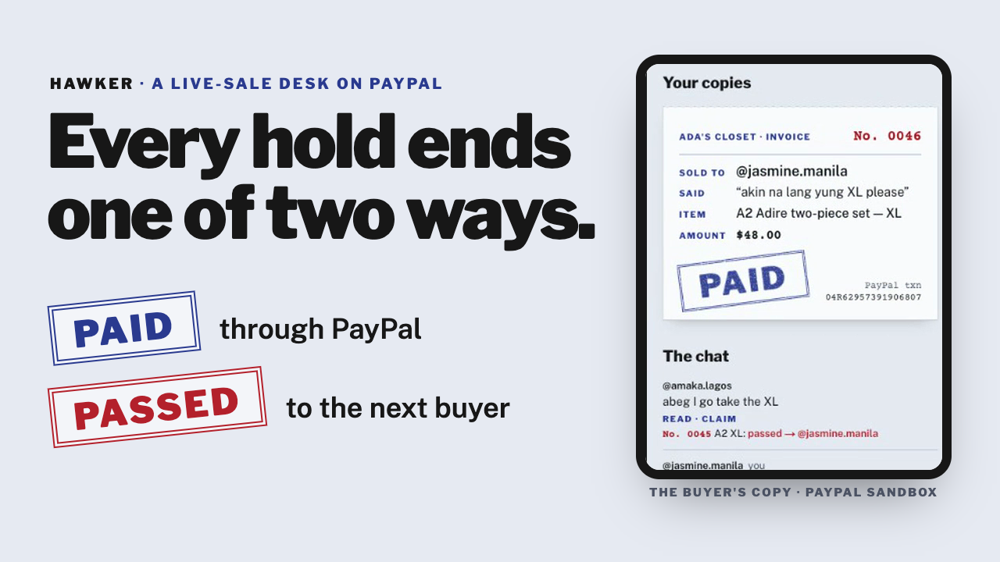
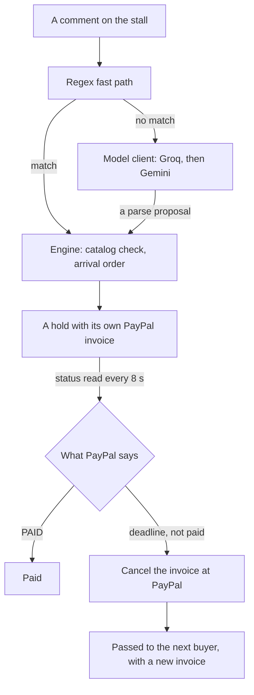

# Hawker

[](https://github.com/emmanuelist/hawker/actions/workflows/ci.yml) [](LICENSE)

## Every hold ends one of two ways: paid through PayPal, or passed to the next buyer.

[](https://youtu.be/xT-LaMUCcXg)

In live selling, the first “mine” in the comments wins the item. In the Philippines, buyers who say “mine” and never pay even have a name: joy miners ([PhilSTAR Life](https://philstarlife.com/living/269097-live-selling-facebook)). Hawker reads a live-sale chat in English, Pidgin or Taglish, turns each “mine” into a timed hold with its own PayPal invoice, and passes an unpaid hold to the next buyer.

Two things make that hard. A keyword rule can't read the chat: on our 63 labelled comments, the regex path alone gets 25 right and misses 18 real claims ([the eval](#the-parsing-eval)). And the ending can't be the seller's call: Hawker reads each invoice's status from PayPal, and there is no mark-as-paid button and no seller override. When the timer runs out, Hawker asks PayPal first. A paid invoice can't be cancelled: PayPal refuses with `CANNOT_CANCEL_PAID_INVOICE`.

**[Live app](https://hawker-8q2t.onrender.com)** · [Try to break it](https://hawker-8q2t.onrender.com/#refusals) · [Buyer's stall](https://hawker-8q2t.onrender.com/s/ada) · [Seller's desk](https://hawker-8q2t.onrender.com/desk) · [Ledger in AG Studio](https://hawker-8q2t.onrender.com/ledger) · [Demo video (2:13)](https://youtu.be/xT-LaMUCcXg) · [Run it locally](#run-it-locally)

PayPal sandbox: no real money moves. Ada's Closet is a demo store with the builder's own catalog.

## What the video shows

1. Amaka claims the last XL in Pidgin, “abeg I go take the XL”. No keyword matches, so a model reads it, and code gives her a three-minute hold with its own PayPal invoice.
2. Jasmine asks for the same XL in Taglish, “akin na lang yung XL please”, and waits first in line.
3. Amaka doesn't pay. At 0:00 Hawker re-reads her invoice from PayPal, finds it unpaid, cancels it, and passes the XL to Jasmine with a new invoice.
4. On the seller's ledger in AG Studio, Hawker's agent re-reads PayPal before it says who still owes. Jasmine pays in PayPal's checkout, and Hawker stamps PAID from PayPal's read.
5. Every other ending is attempted live, at PayPal and in the database, and refused.

## Proof: nothing here is a mockup

Everything below is live right now.

- **The deployed app** runs on Render; [`/api/health`](https://hawker-8q2t.onrender.com/api/health) returns the commit it's running.
- **Every way out, refused.** On the landing, “Try all 9” makes each forbidden ending happen now, on a real copy from the demo stall. PayPal attempts are real API calls; database attempts are rolled back.

  | Attempt | Refused by | Answer |
  |---|---|---|
  | Cancel a paid copy's invoice | PayPal | `422 CANNOT_CANCEL_PAID_INVOICE` |
  | Cancel a passed copy's invoice again | PayPal | `422 INVOICE_CANCELED_ALREADY` |
  | Pay a passed copy late | PayPal | the invoice reads `CANCELLED`; its pay page refuses payment |
  | Turn a paid copy into a passed one | Postgres trigger | `hold_ended` |
  | Turn a passed copy into a paid one | Postgres trigger | `hold_ended` |
  | End a passed copy a second time | Postgres trigger | `hold_ended` |
  | Erase a paid copy from the record | Postgres trigger | `hold_ended` |
  | Give a copy a third ending | Postgres check | `holds_state_check` |
  | Hold a copy with no PayPal invoice | Postgres check | `holds_check` |

- **Real sandbox payments.** The ledger lists every hold with its PayPal invoice and, for each paid copy, the PayPal transaction: No. 0046 from the video is `04R62957391906807`.
- **The evidence log**, [docs/EVIDENCE.md](docs/EVIDENCE.md): every public claim, the proof behind it, and durable captures in [docs/evidence/](docs/evidence/) for anything that can expire.
- **CI** runs lint (zero warnings), typecheck, the tests and the build on every push.

### The parsing eval

63 labelled comments in [eval/cases.json](eval/cases.json): claims, cancels, questions and chatter, in English, Pidgin and Taglish. Only commerce-critical errors count: the wrong intent, or the wrong item, variant or quantity on a claim or cancel. A phantom claim, a hold nobody asked for, fails the run.

| Pipeline | Correct | Phantom claims | Missed claims |
|---|---|---|---|
| Regex fast path only | 25 / 63 | 0 | 18 |
| Fast path, then the model (Groq, with Gemini on failover) | 63 / 63 | 0 | 0 |

Both rows are from 2026-11-08. Model output varies between runs: earlier that day the same set scored 62 / 63, when Gemini read “na wa, price too high” as a question rather than chatter (no hold either way). Every run is saved in [eval/results/](eval/results/).

```bash
npm run eval -- --fast-only   # the regex baseline: no keys, no network
npm run eval                  # the full pipeline (needs GROQ_API_KEY and GEMINI_API_KEY)
```

### Verify without trusting this README

```bash
# The commit the deployed app is running
curl -s https://hawker-8q2t.onrender.com/api/health
# Every hold on the demo stall, with its PayPal invoice and, once paid, its transaction
curl -s https://hawker-8q2t.onrender.com/api/stalls/ada/ledger
```

Then claim something on the [stall](https://hawker-8q2t.onrender.com/s/ada) from your phone and watch it land on the [desk](https://hawker-8q2t.onrender.com/desk), or press “Try all 9” on the [landing](https://hawker-8q2t.onrender.com/#refusals).

The test suite needs no keys and no network:

```bash
git clone https://github.com/emmanuelist/hawker && cd hawker
npm ci
npm test   # 102 tests
```

## How it works



- **Reading.** The regex fast path ([src/lib/parse/fast.ts](src/lib/parse/fast.ts)) runs first. Anything it can't read goes to one model client ([src/lib/ai/client.ts](src/lib/ai/client.ts)) with a timeout, retries, failover from Groq `qwen/qwen3.8-27b` to Gemini `gemini-3.5-flash-lite`, and a log line per call. The model only proposes a parse.
- **Deciding.** Plain code ([src/lib/domain/engine.ts](src/lib/domain/engine.ts)) commits holds in the order comments arrived, checks item codes and variants against the catalog, and answers anything unknown with a clarifying reply. The model never decides who gets an item. A size whose units are all paid for is sold: there's no line to join, and anyone still waiting when the last one is paid for ends Passed, told why.
- **Settling.** Each hold gets its own PayPal invoice with `allow_partial_payment: false` ([src/lib/paypal/client.ts](src/lib/paypal/client.ts)). Payment truth is a status read: open invoices are re-read every 8 seconds. At the deadline, Hawker re-reads the invoice: PAID is never passed, and anything else is cancelled at PayPal and offered to the next buyer with a new invoice ([`endHolding`](src/lib/service/holds.ts#L208)).
- **Guarding.** A Postgres trigger makes an ended hold final ([db/migrations/003_ended_is_final.sql](db/migrations/003_ended_is_final.sql)). The only later write it allows is linking a passed hold to the next buyer's, once.
- **Watching.** The stall, desk, landing and ledger update live over server-sent events.
- **The ledger** ([src/app/ledger/LedgerStudio.tsx](src/app/ledger/LedgerStudio.tsx)) is AG Studio with Hawker's theme and its own widgets (Stamp filter, Two endings, Who owes now). Hawker's agent is the primary agent in Studio's agent framework, with its own tools: `who_owes_now` re-reads each open invoice from PayPal, `ledger_totals` counts from the ledger rows, and `add_breakdown_chart` builds a chart in code. It hands other dashboard edits to Studio's lead agent, and Studio's built-in agents run on Hawker's model client.

## Limits

- PayPal sandbox only; no real money moves.
- Buyers comment on Hawker's stall page, whose link the seller pins in the live. Reading TikTok, Facebook or Instagram Live comments directly needs platform approval and isn't built.
- A hold can outlive its timer while PayPal is unreachable. Hawker never passes a hold it couldn't check with PayPal; it retries until PayPal answers.
- PAID shows 8–13 seconds after the buyer pays, because Hawker polls PayPal rather than trusting webhooks (sandbox webhooks weren't delivered in our testing).
- One server process on Render's free plan, kept awake by a keep-warm request. Open deadlines live in memory and reload from the database on restart.
- The models run on free tiers. Hawker's agent can hand work to Studio's built-in agents, but on these tiers it isn't reliable: one delegated widget rendered unconfigured.
- Paid units never come back, so the demo store's stock shrinks as people pay.
- The eval is 63 comments we labelled ourselves.
- AG Studio runs on a trial licence key.
- The live app's counters include our own test runs and break tests.

## AI used, and how

- **In the product:** Groq `qwen/qwen3.8-27b` reads the comments the regex path can't and answers the ledger agent's turns. Gemini `gemini-3.5-flash-lite` takes over on rate limits, errors, and turns too long for Groq's free tier. AG Studio's agent framework hosts the ledger agent.
- **Building it:** Claude Code (Anthropic) wrote and reviewed code with the author.

## Run it locally

Requires Node 26 (`.node-version`), a PayPal sandbox REST app with Invoicing enabled, a Postgres database (Neon's free tier works), and Groq and Gemini API keys.

```bash
cp .env.example .env   # every key is described there
npm install
npm run db:migrate && npm run db:seed
npm run dev            # http://localhost:3000
```

Gate: `npm run lint && npm run typecheck && npm test && npm run build`. Build notes: [docs/STATE.md](docs/STATE.md), [docs/DECISIONS.md](docs/DECISIONS.md), [docs/CONTEXT.md](docs/CONTEXT.md).

## License

MIT
